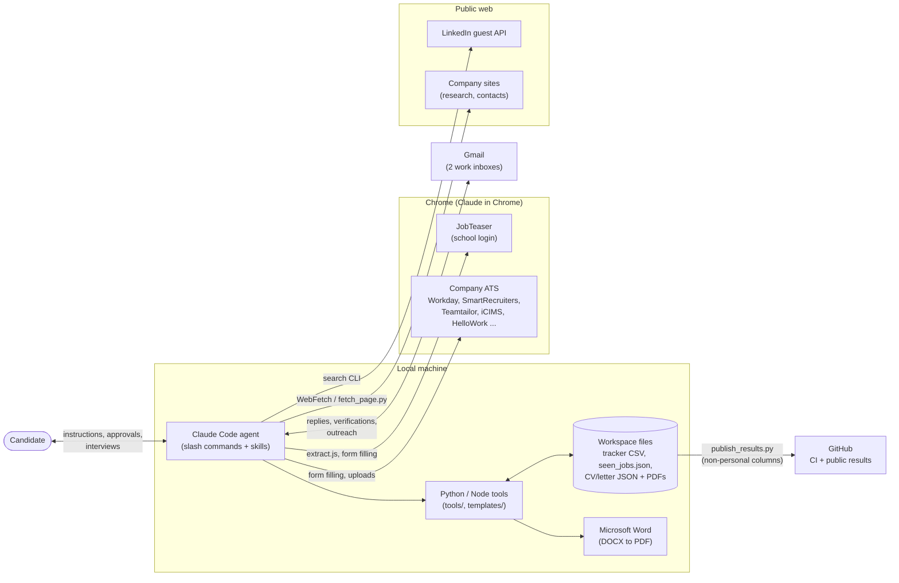
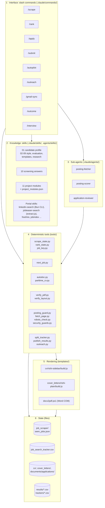
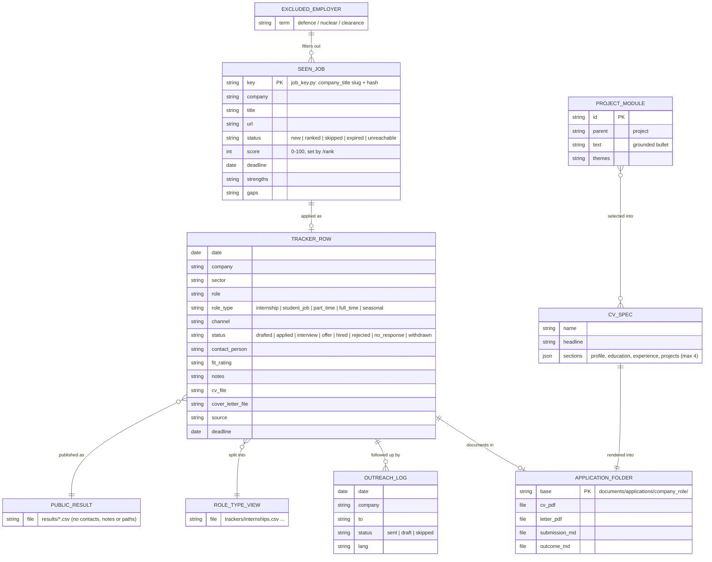
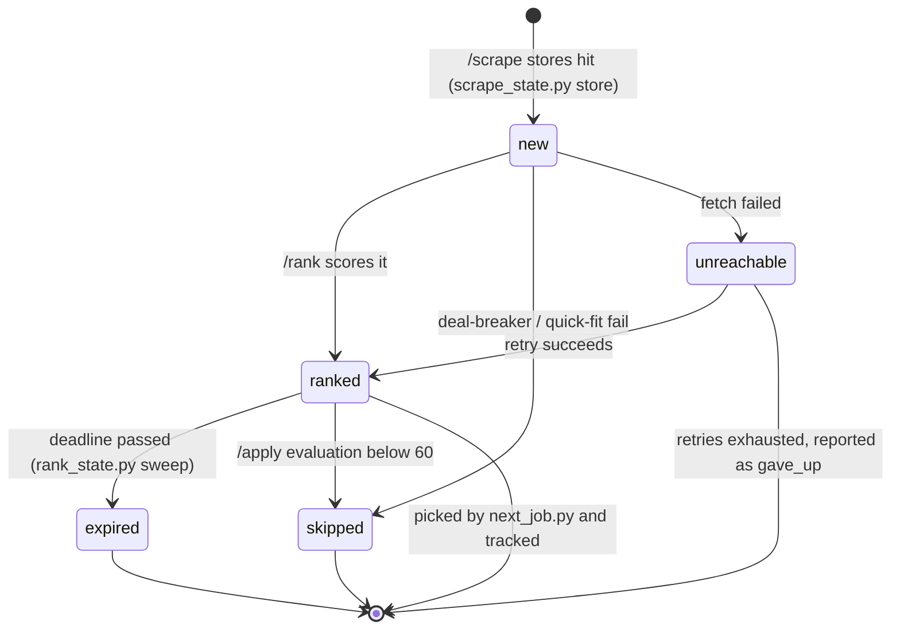
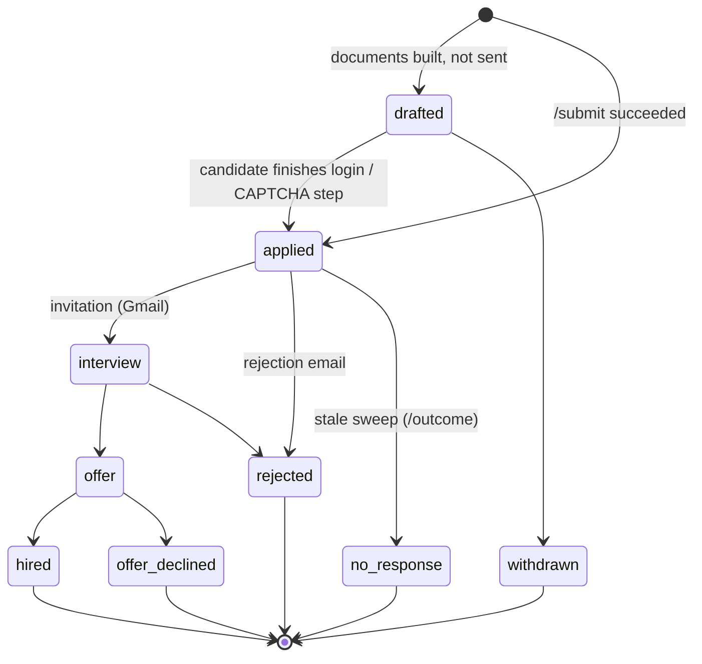
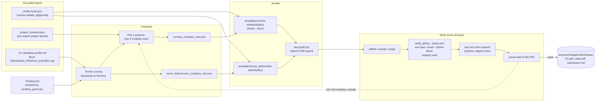
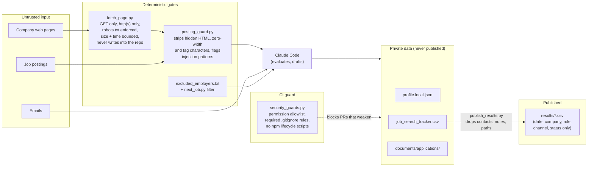
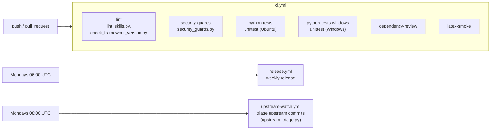

# Architecture

Technical reference for this fork of [ai-job-search](https://github.com/MadsLorentzen/ai-job-search). It covers what the system is made of, where state lives, how documents are built and checked, and where the trust boundaries are.

For the step-by-step workflows (scrape, rank, apply, submit, follow-up), see [WORKFLOWS.md](WORKFLOWS.md).

All diagrams are [Mermaid](https://mermaid.js.org/) and render directly on GitHub.

---

## 1. System context

The repository holds no server or database. It is a **Claude Code workspace**: an agent (Claude Code) reads Markdown instructions and calls small deterministic tools, with plain files on disk as its state. Outside systems are reached in three ways: portal CLIs over HTTP, the logged-in Chrome browser (Claude in Chrome), and the Gmail connector.



---

## 2. Layered component view

The system splits into an **instruction layer** that the model interprets and a **deterministic layer** of code. Anything that must be exact (dedup keys, ranking order, page counts, ignore rules) lives in code and is pinned by tests. Anything that needs judgement (fit scoring, writing, reading a form) is left to the model, and checked by code wherever possible.



### Why the deterministic layer exists

| Problem when left to the model | Tool that fixes it |
|---|---|
| `seen_jobs.json` grows forever; re-reading it costs context on every run | `scrape_state.py`, `rank_state.py` project only the fields needed and write back atomically |
| The same job stored twice under slightly different keys | `job_key.py`: a pure, length-capped, hash-disambiguated key |
| Choosing the next job inconsistently, or re-applying | `next_job.py`: drops tracked jobs, excluded employers and passed deadlines, sorts by urgency then score |
| A CV that "looks" one page but clips a row or loses its text layer | `verify_pdf.py`, `verify_layout.py` |
| Hidden prompt-injection text in a posting | `posting_guard.py` |
| Permission widening or weakened `.gitignore` slipping into a PR | `security_guards.py` (CI) |

---

## 3. Data model

All state is plain files. `job_search_tracker.csv` is the single source of truth for applications; everything under `trackers/` and `results/` is generated from it.



### Lifecycle of a scraped job (`seen_jobs.json`)



### Lifecycle of an application (`job_search_tracker.csv`)



Final states: `hired`, `rejected`, `no_response`, `offer_declined`, `withdrawn`. A `drafted` row is open but never gets a follow-up, because nothing was sent.

---

## 4. Document pipeline

Every CV and cover letter is generated from **grounded content only**: the candidate profile and the project-module bank. No claim is written by hand for a single job. The pipeline is the same for `/apply` (model-tailored text) and `autodoc.py` (template-driven text); only the composition step differs.



**Document rules** enforced in this pipeline:

- CV: 1 page, `rishi-sidebar`, 4 projects at most with 2 modules each, in English unless the posting is French-speaking.
- Letter: 1 page, `rishi-plain`, written in the posting's language.
- Availability is always "available immediately, with a convention de stage". No graduation, start or permit dates are ever printed.
- Gaps are left out, never hedged.

---

## 5. Trust boundaries and security

Postings, emails and web pages are **third-party text**, read next to the candidate's personal data. The design treats them as data, never as instructions, and backs that rule with code wherever it can.



**Hard limits the agent never crosses:** no passwords, no CAPTCHAs, no optional marketing consents, and no answer to a screening question that is not in `10-screening-answers.md`. An unknown question queues the job in `documents/manual_apply_queue.md` for the candidate.

---

## 6. CI/CD



Run the test suite locally with:

```bash
python -m unittest discover -s tests -t . -v
python tools/security_guards.py
python tools/lint_skills.py
```

---

## 7. Tool reference

| Tool | Purpose | Typical call |
|---|---|---|
| `tools/next_job.py` | Next best-fit job: ranked, score ≥ 60, not tracked, not excluded, deadline first | `python tools/next_job.py --limit 3` / `--count` |
| `tools/scrape_state.py` | Dedup search hits against history and tracker, store atomically | `candidates`, `store` |
| `tools/rank_state.py` | Select jobs for scoring, expiry sweep, write scores back | `candidates`, `sweep`, `apply` |
| `tools/job_key.py` | Canonical dedup key, audit and migrate old keys | `--audit [--migrate]` |
| `tools/posting_guard.py` | Clean a posting and flag hidden or injected text | piped posting HTML/text |
| `tools/fetch_page.py` | Browser-header GET retry for 403 sites (robots-gated) | `python tools/fetch_page.py <url> --text` |
| `tools/autodoc.py` | Template-driven CV + letter build and verify; Workday bulk pipeline | `build-ext spec.json`, `thales-fetch`, `thales-queue`, `record` |
| `tools/parttime_cv.py` | Part-time CV variants per job type (cashier, stock, restaurant, retail, service) | `Slug:caisse ...` |
| `tools/verify_pdf.py` | Page count, text layer, required strings, ASCII date ranges | `cv.pdf --pages 1 --dump-text cv.txt` |
| `tools/verify_layout.py` | Orphaned entries, holes, footer collisions (Poppler bbox) | `cv.pdf` |
| `tools/outreach.py` | Eligible follow-ups, outreach log, daily cap stats | `candidates`, `log`, `stats` |
| `tools/split_tracker.py` | Normalise `role_type`, write `trackers/*.csv`, print counts | `python tools/split_tracker.py` |
| `tools/publish_results.py` | Public `results/*.csv` + README summary table | `python tools/publish_results.py [--check]` |
| `tools/security_guards.py` | Supply-chain and privacy guards (CI) | `python tools/security_guards.py` |
| `tools/workday_thales.js` | In-page helper for Workday application forms | loaded in the browser per the playbook |

---

## 8. Repository map

```text
.claude/
  commands/           slash commands (/apply, /rank, /submit, /autopilot, /outreach ...)
  skills/             job-application-assistant (01-11), job-scraper, upskill
  agents/             posting-fetcher, posting-scorer, application-reviewer
.agents/skills/       portal search skills (LinkedIn CLI, JobTeaser extract.js, ...)
tools/                deterministic Python/JS helpers (see table above)
templates/            DOCX templates: cv/rishi-sidebar, cover_letters/rishi-plain
tests/                unittest suite run by CI on Ubuntu and Windows
job_scraper/          seen_jobs.json (gitignored), excluded_employers.txt
results/              public, non-personal results per job type
docs/                 this documentation
documents/            personal inputs and per-application folders (gitignored)
job_search_tracker.csv  the single source of truth (gitignored)
```
