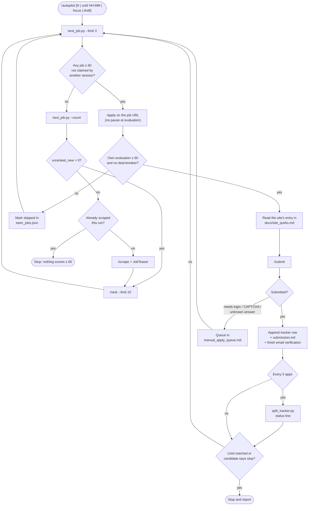
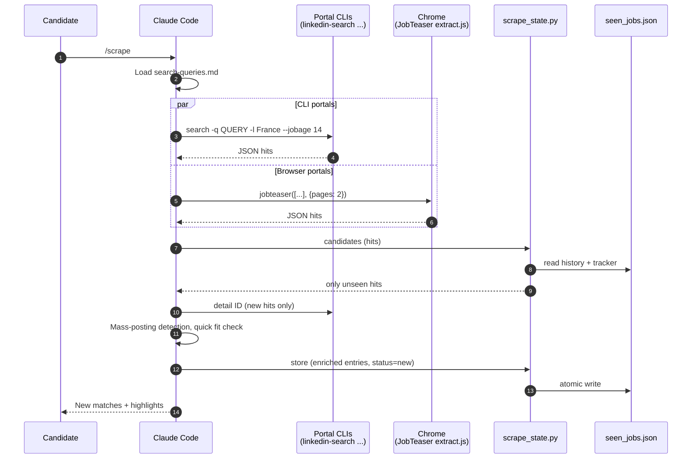
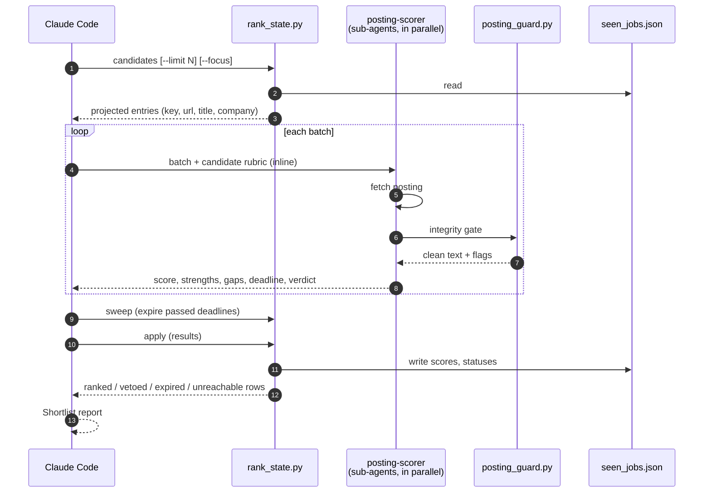
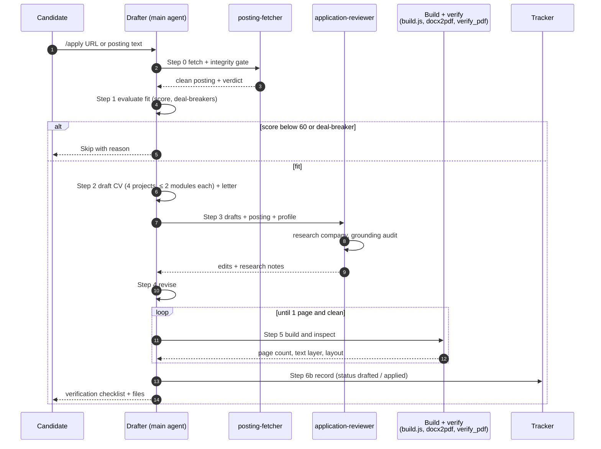
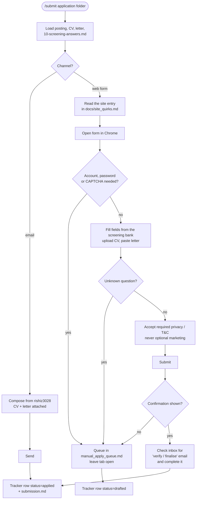
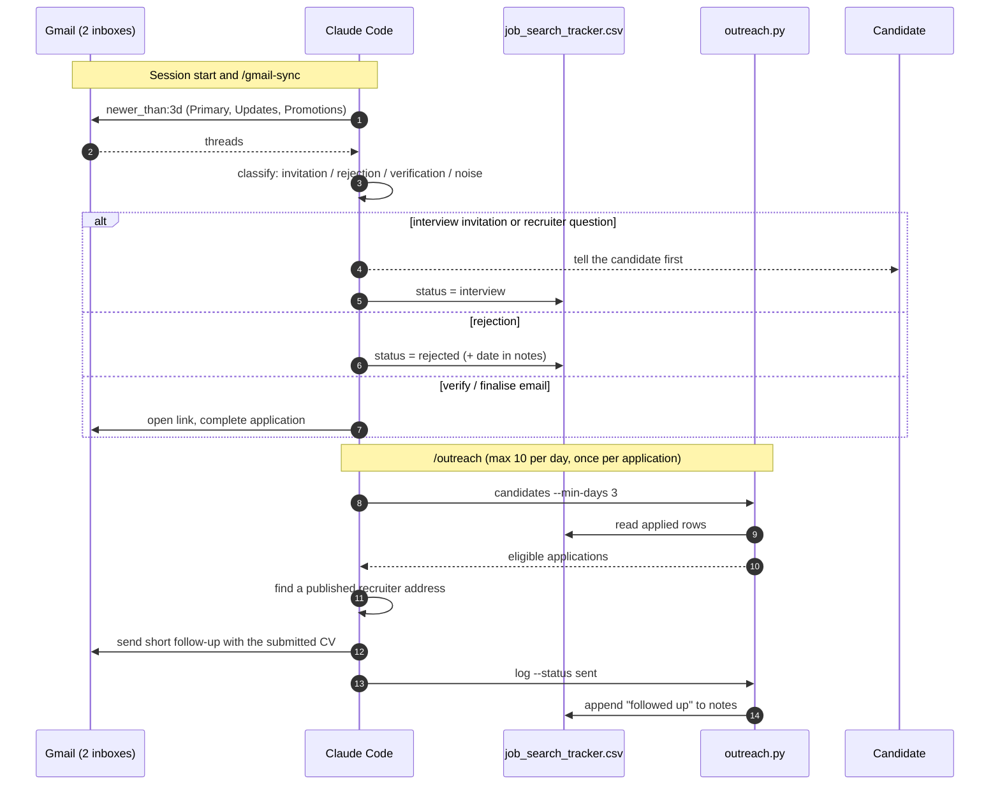
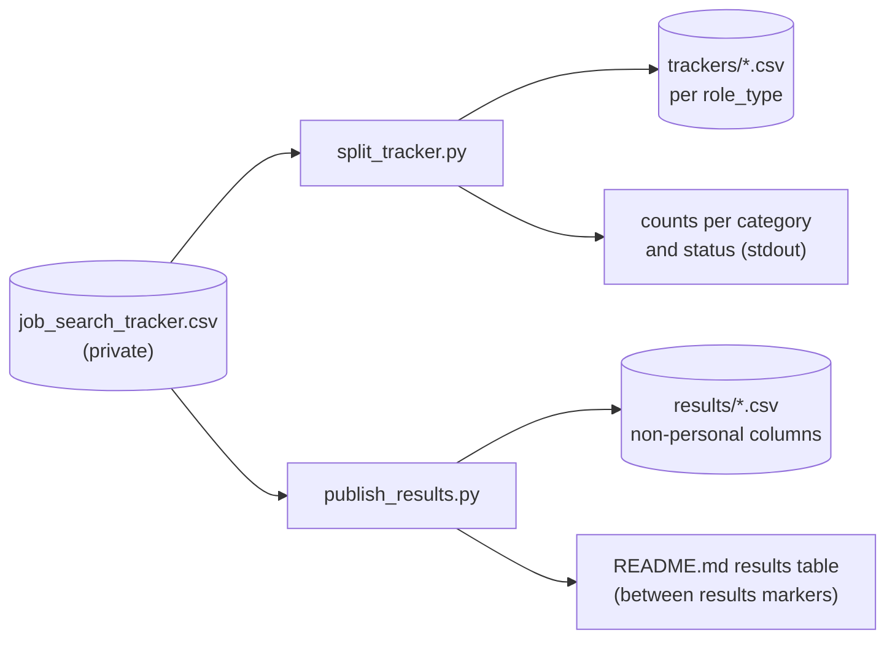

# Workflows

How a job goes from a search result to a submitted application, then to a follow-up and an outcome. Each section names the command or tool that runs the step. For the components and data model behind these steps, see [ARCHITECTURE.md](ARCHITECTURE.md).

---

## 1. End-to-end pipeline

```mermaid
flowchart LR
    start(["Session start"]) --> inbox["Check both work inboxes<br/>(Primary, Updates, Promotions)"]
    inbox --> scrape["/scrape<br/>LinkedIn CLI, JobTeaser,<br/>HelloWork, freehire"]
    scrape --> rank["/rank<br/>posting-scorer sub-agents<br/>score 0-100"]
    rank --> pick["next_job.py<br/>best fit first"]
    pick --> apply["/apply<br/>evaluate, draft,<br/>review, build, verify"]
    apply --> submit["/submit<br/>email or web form"]
    submit --> record["Record<br/>tracker row +<br/>submission.md"]
    record --> sync["/gmail-sync<br/>replies to tracker"]
    sync --> outreach["/outreach<br/>recruiter follow-up"]
    outreach --> outcome["/outcome, /interview"]
    record -->|"next job"| pick
```



`/autopilot` runs the `pick → apply → submit → record` loop by itself until a stop condition is hit (section 2).

---

## 2. `/autopilot`: the continuous loop



**Selection rules in `next_job.py`:** status `ranked`, score ≥ 60, not already in the tracker (company plus a similar title, on any channel), employer not in `excluded_employers.txt`, deadline not passed. Jobs closing within 7 days come first, then the rest by score.

---

## 3. `/scrape`: finding postings



---

## 4. `/rank`: scoring the shortlist



**What keeps a job off the shortlist:** a location or language gate `FAIL` (for example, fluent French required), or one of the candidate's deal-breakers: a full-time CDI/CDD, alternance or VIE contract, a defence or nuclear employer, a security clearance or EU nationality requirement, or internship pay below 600 EUR/month. A `FLAG` keeps the job in the ranking with a ⚠ marker for the candidate to judge. A posting that `posting_guard.py` flags is still scored, and the flag is shown to the candidate.

---

## 5. `/apply`: drafter-reviewer loop



---

## 6. `/submit`: sending the application



---

## 7. Inbox sync and follow-up



---

## 8. Reporting



Run at the end of every batch:

```bash
python tools/split_tracker.py
python tools/publish_results.py
```

---

## 9. Daily routine (cheat sheet)

| When | Do | Command |
|---|---|---|
| Session start | Read both work inboxes, update the tracker, report invitations | (manual, mandatory) |
| Queue empty | Refill the job queue | `/scrape` then `/rank` |
| Working | Apply in fit order with tailored documents | `/autopilot` or `/apply` + `/submit` |
| After a batch | Regenerate views and publish | `split_tracker.py`, `publish_results.py` |
| After a batch | Pull replies into the tracker | `/gmail-sync` |
| Daily, ≤ 10 | Recruiter follow-ups | `/outreach` |
| Interview booked | Build a prep pack | `/interview` |
| Result known | Close the application | `/outcome` |
